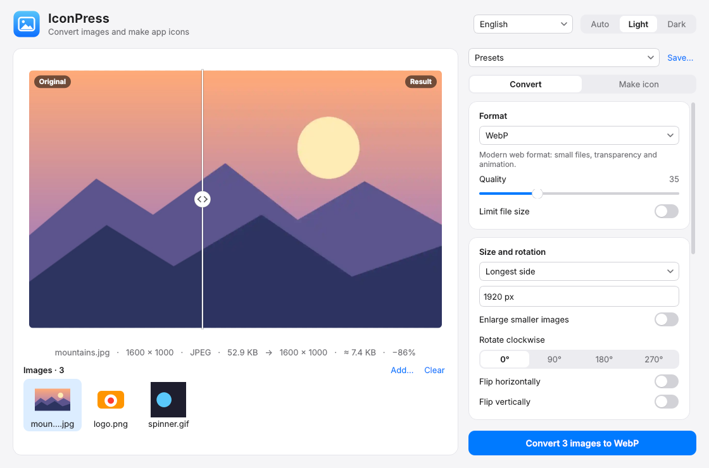
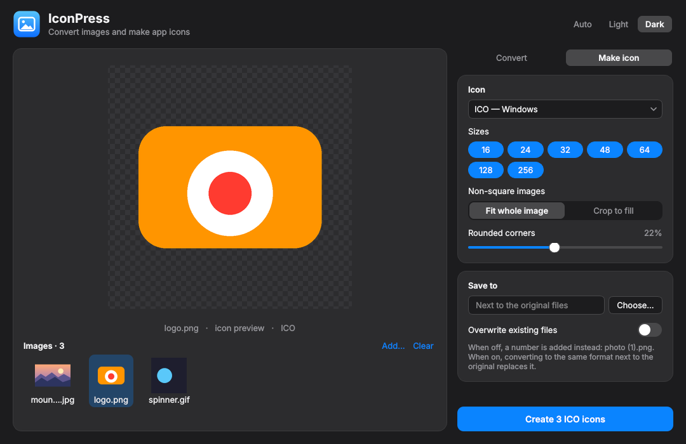

# IconPress

🖼️ Image converter and icon maker with a clean, modern interface


-green.svg)





## Features

- **Batch conversion**: PNG, JPEG, WebP, AVIF, GIF, TIFF and BMP, for one image or a whole folder
- **Drag and drop**: drop files or folders anywhere on the window
- **Handles awkward images**: palette GIFs, 16-bit PNGs, CMYK JPEGs and transparent images all
  convert correctly. Transparency becomes white in JPEG, phone photos stay upright (EXIF
  rotation), colour profiles are kept, and animated GIF/WebP/PNG stay animated
- **Quality and size**: quality slider for JPEG, WebP and AVIF, plus an optional max size
- **Icons for every platform**:
  - `.ico` for Windows, with the sizes you pick (16–256 px)
  - `.icns` for macOS
  - a set of PNGs for the web and apps (favicon, Apple touch icon, Android, …)
- **Live icon preview**: non-square images are fitted or cropped (never stretched); rounded corners
  are optional
- **Safe saving**: existing files are never overwritten unless you turn it on, and a number is
  added instead (`photo (1).png`)
- **Light and dark theme**: follows the system automatically or can be set by hand. Settings are
  remembered between launches
- **19 languages**: English, Deutsch, Español, Français, Bahasa Indonesia, Italiano, Nederlands,
  Polski, Português (Brasil), Tiếng Việt, Türkçe, Русский, Українська, العربية, हिन्दी, 日本語,
  한국어, 简体中文 and 繁體中文. The system language is picked automatically, and you can switch in
  the window. Arabic uses a right-to-left layout

## Install and run

Requires Python 3.10 or newer. Install the dependencies first (PySide6 and Pillow), then start
the app:

```bash
git clone https://github.com/bboyJohnn/IconPress.git
cd IconPress
python -m pip install -r requirements.txt
python IconPress.py
```

`python -m pip` installs into the same Python that runs the app. On Windows a bare `pip` can
belong to a different Python installation.

Or install it as a command:

```bash
pip install .
iconpress            # or: iconpress photo.jpg logo.png …
```

## Tips

| Action | Shortcut |
| --- | --- |
| Add images | `Ctrl+O` / `⌘O` |
| Convert / create icons | `Ctrl+Enter` / `⌘↩` |
| Remove selected images | `Delete` or `Backspace` in the image list |

- **Replace the original:** keep *Save to* empty, turn on *Overwrite existing files*, and convert
  to the same format (for example, to shrink or recompress a JPEG).
- Right-click an image in the list to remove it or show it in its folder.

## Development

```bash
pip install -e ".[dev]"
ruff check .
pytest
```

GUI tests run without a display (`QT_QPA_PLATFORM=offscreen`, set automatically by the tests).

### Translations

Each language is a JSON file in `iconpress/locales/`. The keys are the English texts, as they
appear in the code inside `tr("…")`. Texts with a number use plural forms (`one`, `few`,
`many`, `other`, … following [CLDR](https://cldr.unicode.org/index/cldr-spec/plural-rules)):

```json
"Saved {n} files.": {"one": "Сохранён {n} файл.", "few": "Сохранено {n} файла.", "many": "Сохранено {n} файлов."}
```

To add a language, copy `en.json`, translate the values, and add the language to `LANGUAGES`
(and its plural rule, if it is new) in `iconpress/i18n.py`. `pytest` checks that every file
has all texts, the right placeholders and every plural form the language needs.

```
iconpress/
├── core.py     # all image processing (Pillow only, no Qt): conversion, icons, file naming
├── app.py      # main window, background worker, settings
├── widgets.py  # switch, segmented control, preview / drop zone
├── theme.py    # light and dark themes
├── i18n.py     # translations, plural rules, language detection
└── locales/    # one JSON file per language
tests/          # pytest: core logic and GUI smoke tests
```
